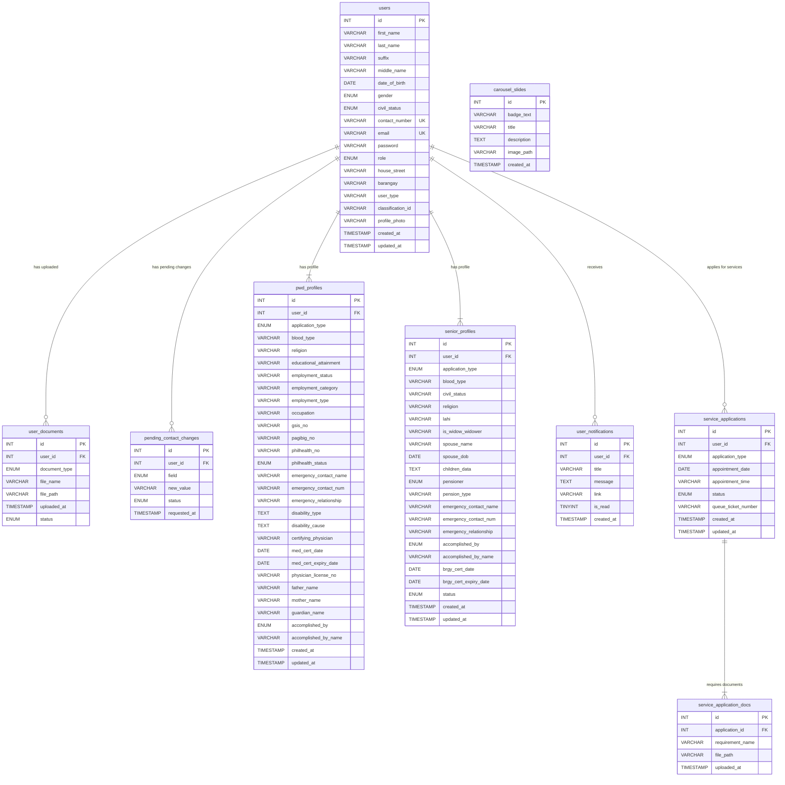

# Database Entity Relationship (ER) Diagram

Based on the `database.sql` schema within your project (and the recent feature removals), here is the Entity Relationship Diagram for the BIDA Portal. 

## Overview of Relationships

- **Users Core:** The central entity is the `users` table. Almost all other tables have a foreign key linking back to it (`user_id`).
- **One-to-Many Relationships:** A single user can have multiple:
  - Uploaded documents (`user_documents`)
  - Pending contact changes (`pending_contact_changes`)
  - PWD profiles (`pwd_profiles`)
  - Notifications (`user_notifications`)
  - Service applications (`service_applications`)
- **Service Applications:** A specific service application can have multiple supporting documents attached to it (`service_application_docs`).
- **Standalone:** The `carousel_slides` table exists independently and is not tied directly to user data.
